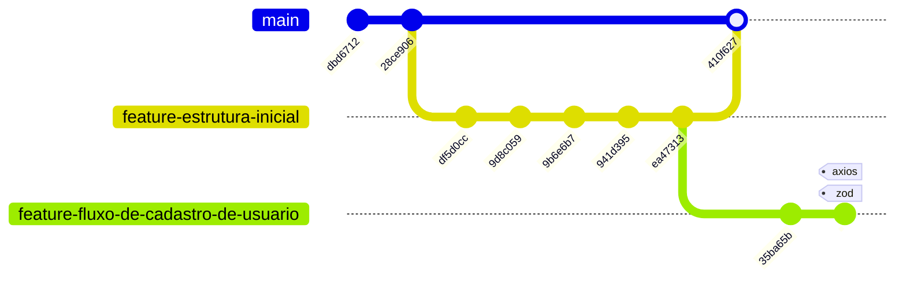

# Welcome to your Expo app BiCity 👋

This is an [Expo](https://expo.dev) project created with [`create-expo-app`](https://www.npmjs.com/package/create-expo-app).



<link rel="stylesheet" href="https://cdnjs.cloudflare.com/ajax/libs/font-awesome/6.1.0/css/all.min.css">
<h1 align="center">
  
</h1>

# PI1A5 - Projeto Integrado I - BiCity

## Informações Gerais

<!-- Informações do curso e professor -->
<div align="left"> 
<p>Trabalho apresentado na matéria de  PI1A5 - Projeto Integrado I
                do curso Superior de Tecnologia em Análise e
                Desenvolvimento de Sistemas do Instituto Federal de
                Educação, Ciência e Tecnologia de São Paulo.<br>
                Orientador: Prof.Bernardo e Prof.Palladino
        </p>
<!-- Redirecionamento de para redes sociais com Icones -->
 <div>   
  <a href="#" target="_blank"></a> 
  <a href="#" target="_blank"></a>
</div>
</div></br>
</br>
<!--****************************************************************************************************************-->
<!-- Informações do Aluno -->

# Contributors ✨

Thanks goes to these wonderful people:

<!-- ALL-CONTRIBUTORS-LIST:START - Do not remove or modify this section -->
<!-- prettier-ignore-start -->
<!-- markdownlint-disable -->
<table align="center">
  <tr>
    <tr>
   <td align="center"><a href="https://github.com/CaioARL"><br/><sub><b>Caio Arruda</b></sub></a><br /><a href="https://github.com/CaioARL" title="GitHub"></a><a href="#" title="Linkedin"></a></td>
    <td align="center"><a href="https://github.com/GabrielAlvesGit"><br/><sub><b>Gabriel Josué</b></sub></a><br /><a href="https://github.com/GabrielAlvesGit" title="GitHub"></a><a href="https://www.linkedin.com/in/gabrielalv3s/" title="Linkedin"></a></td><td align="center"><a href="https://github.com/gabuh"><br/><sub><b>Gabriel Josué</b></sub></a><br /><a href="https://github.com/GabrielAlvesGit" title="GitHub"></a><a href="https://www.linkedin.com/in/gabrielalv3s/" title="Linkedin"></a></td>
    <td align="center"><a href="https://github.com/jhomarcelo"><br/><sub><b>Jhonatan Marcelo</b></sub></a><br /><a href="https://github.com/jhomarcelo" title="GitHub"></a><a href="https://www.linkedin.com/in/jhonatan-marcelo/" title="Linkedin"></a></td>
    <td align="center"><a href="https://github.com/c0zyhug"><br/><sub><b>Kayan Garbi</b></sub></a><br /><a href="https://github.com/c0zyhug" title="GitHub"></a><a href="https://www.linkedin.com/in/kayan-garbi/" title="Linkedin"></a></td> 
  </tr>
</table>

<!-- Tecnologias utilizadas no projeto -->

## Tecnologias

<div align="center">
    
    
    
    
    
    
    
    
</div>

## Descrição do Projeto

## Get started

1. Install dependencies

    ```bash
    npm install
    ```

2. Instalar dependências específicas

    ```bash
    npm install react-native-maps
    expo install expo-location
    npm install geojson - Caso necessario
    ```

3. Start the app

    ```bash
     npx expo start
    ```

## Create new branch

1. Crie a nova branch

    ```
     Lembre de manter o padrão "feature-"
     git checkout -b feature-nome-que-voce-vai-add
    ```

2. No VSCode, no canto inferior esquerdo, você verá a branch atual em que está trabalhando. Verifique se ela mostra o nome correto da nova branch, por exemplo:

    ```
      feature-filtro-do-mapa
    ```

3. Adicione as alterações

    ```
      git add .
    ```

4. Faça o commit com a mensagem adequada

    ```
     git commit -m "Adiciona funcionalidade...."
    ```

5. Empurre a nova branch para o repositório remoto

    ```
      git push origin feature-nome-que-voce-vai-add
    ```

In the output, you'll find options to open the app in a

-   [development build](https://docs.expo.dev/develop/development-builds/introduction/)
-   [Android emulator](https://docs.expo.dev/workflow/android-studio-emulator/)
-   [Alternativa para a instalação do Android emulator](https://www.youtube.com/watch?v=dNhHv4JzsTw)
-   [iOS simulator](https://docs.expo.dev/workflow/ios-simulator/)
-   [Expo Go](https://expo.dev/go), a limited sandbox for trying out app development with Expo

You can start developing by editing the files inside the **app** directory. This project uses [file-based routing](https://docs.expo.dev/router/introduction).

## Get a fresh project

When you're ready, run:

```bash
npm run reset-project
```

This command will move the starter code to the **app-example** directory and create a blank **app** directory where you can start developing.

## Learn more

To learn more about developing your project with Expo, look at the following resources:

-   [Expo documentation](https://docs.expo.dev/): Learn fundamentals, or go into advanced topics with our [guides](https://docs.expo.dev/guides).
-   [Learn Expo tutorial](https://docs.expo.dev/tutorial/introduction/): Follow a step-by-step tutorial where you'll create a project that runs on Android, iOS, and the web.

## Join the community

Join our community of developers creating universal apps.

-   [Expo on GitHub](https://github.com/expo/expo): View our open source platform and contribute.
-   [Discord community](https://chat.expo.dev): Chat with Expo users and ask questions.
